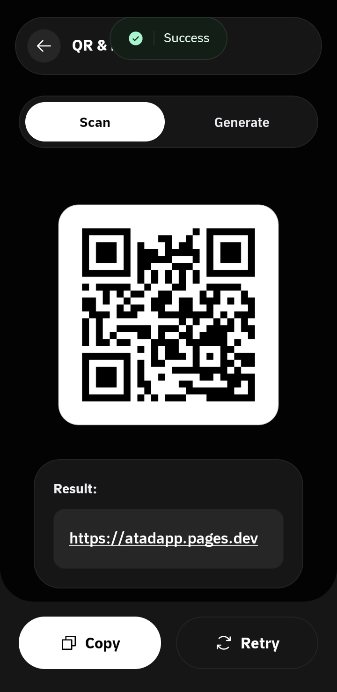
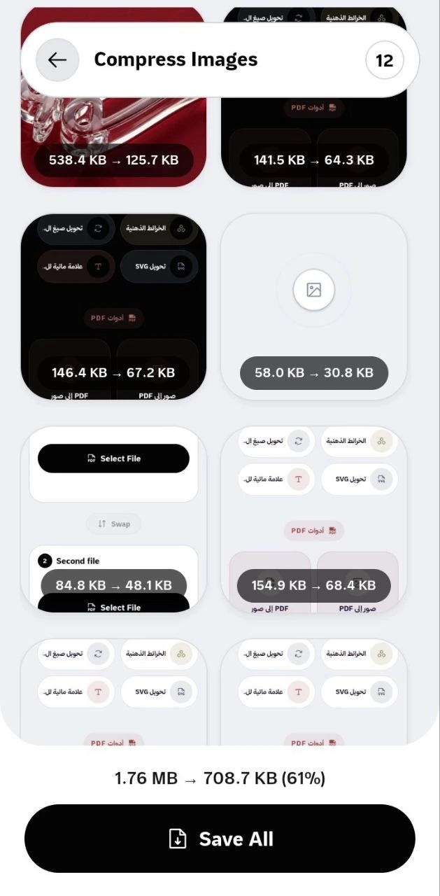
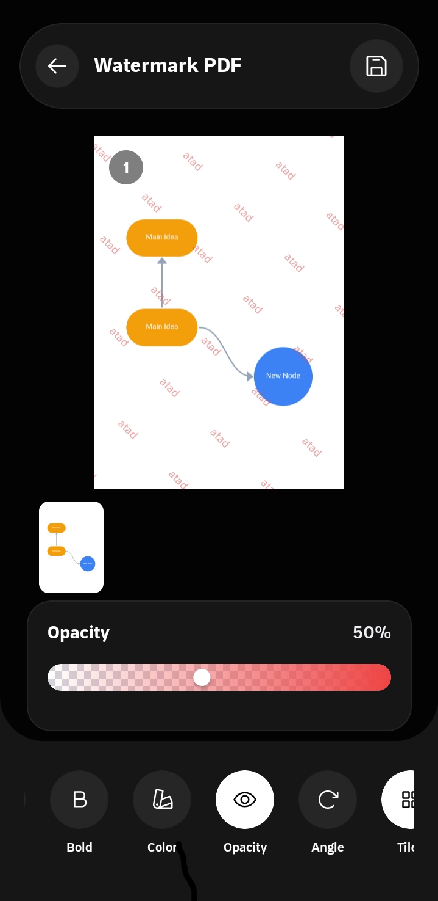
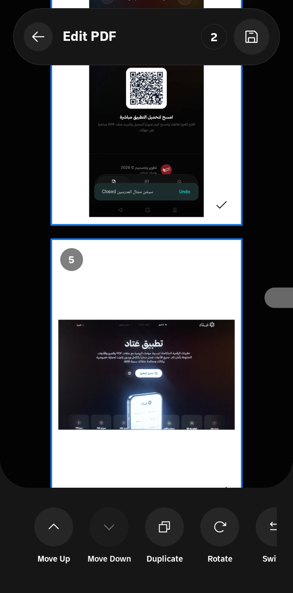
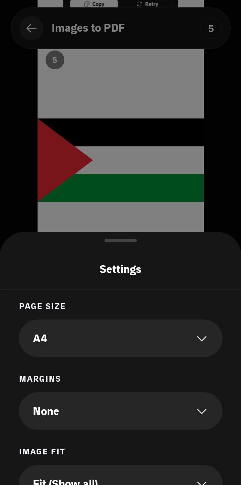
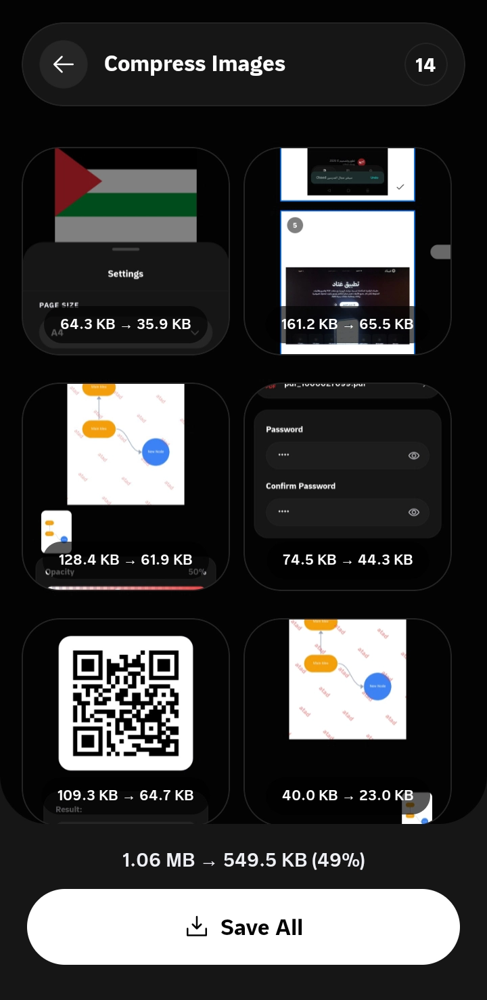
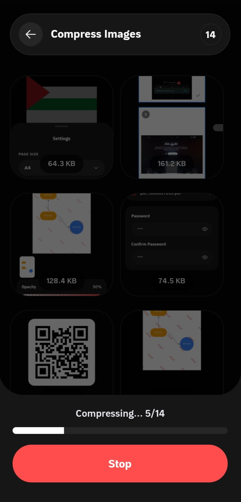
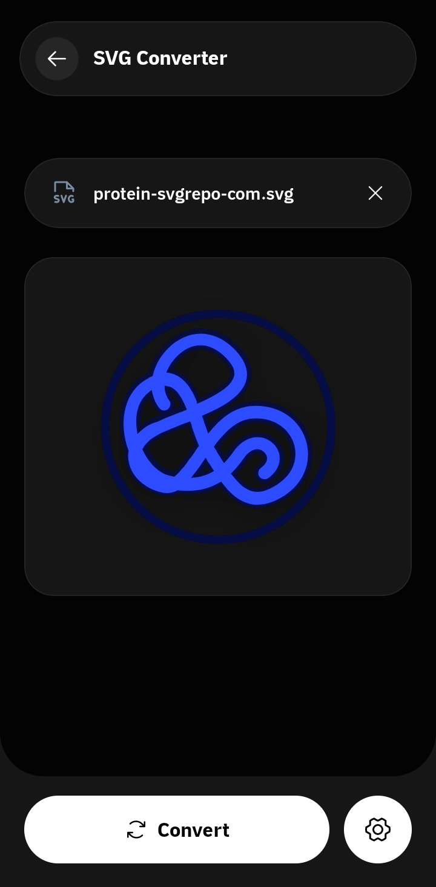
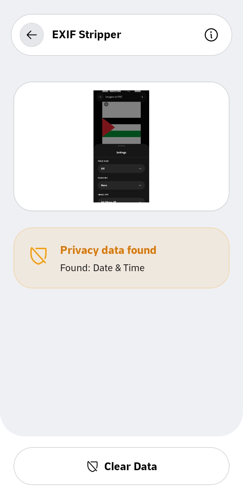

# Atad - عتاد

<h3 align="center">
  A free app featuring +14 productivity tools that work locally for editing PDFs, images, and other useful utilities
</h3>

English
&nbsp;&nbsp;| &nbsp;&nbsp;
<a href="README_ar.md">العربية</a>

 

 

 

## ✨ Features

* Over 14 productivity tools for PDFs and images, plus other useful utilities.
* All tools work fully locally without an internet connection.
* No files or data are ever sent to external servers.
* PDF conversion, image compression, and encryption are processed locally at lightning speed, thanks to modern data processing technologies.
* Works in the background, so you can continue using your phone while waiting, and it will send you a notification as soon as it's finished.
* Enjoy a clean and fast user experience with zero ads or trackers.
* No subscriptions, usage limits, or ads... completely free app.
* More than 5 tools for editing PDF files.
* 4 tools for image conversions and compression.
* In addition to various other tools such as creating mind maps, generating and reading QR codes, color extractor, and wallpaper creator.
* Additional options available for each tool.
* The app supports 3 languages: Arabic, English, and Spanish.

 

## 📸 Screenshots

  &nbsp;&nbsp;
  &nbsp;&nbsp;
  &nbsp;&nbsp;
  &nbsp;&nbsp;
  &nbsp;&nbsp;
  &nbsp;&nbsp;
  &nbsp;&nbsp;
  &nbsp;&nbsp;
  &nbsp;&nbsp;

 

## 📥 Download

You can download the latest version of the app via the [Releases](https://github.com/you0ssef/Atad/releases) page.

> 💡 **Tip:** If you do not know which version is compatible with your device, please download the **Universal** version, as it works on all supported devices.

 

## 💬 Reporting Issues and Suggestions

Found a bug or have a suggestion? Please open an **[Issue](https://github.com/you0ssef/Atad/issues)**

 

## 📜 License

Atad app is free to use  
All rights reserved ©

