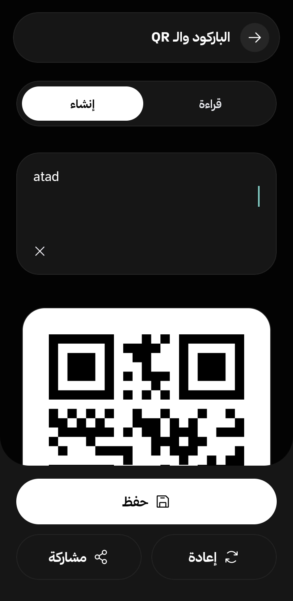
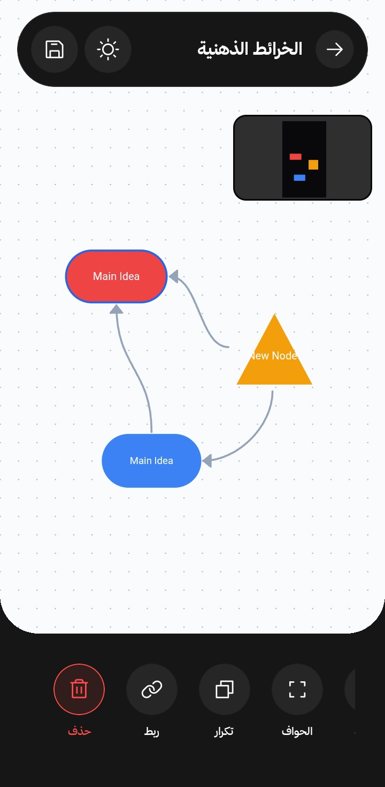
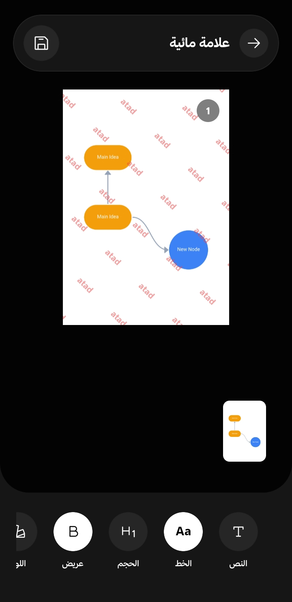
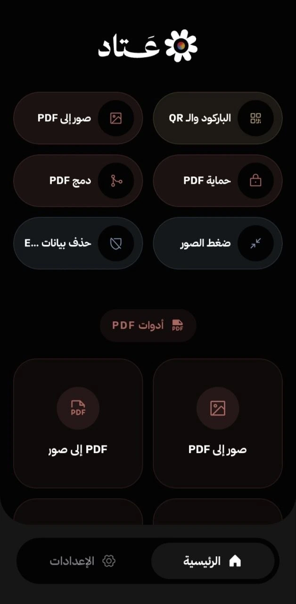
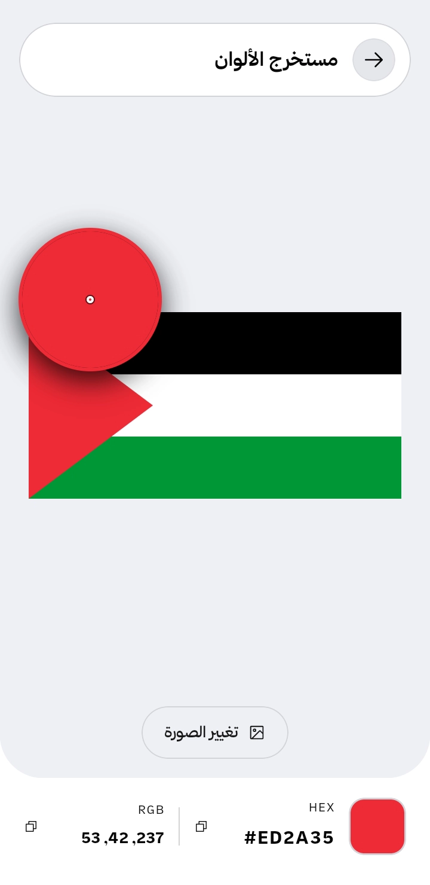
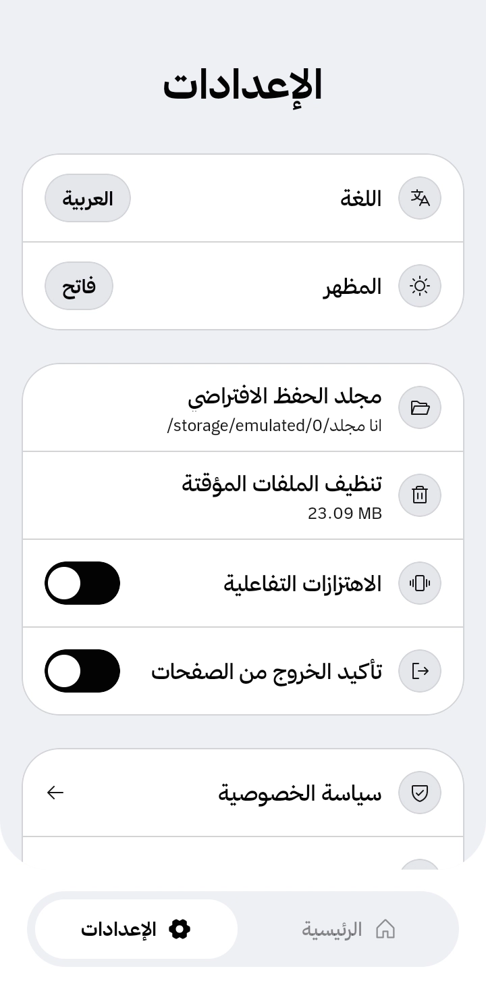
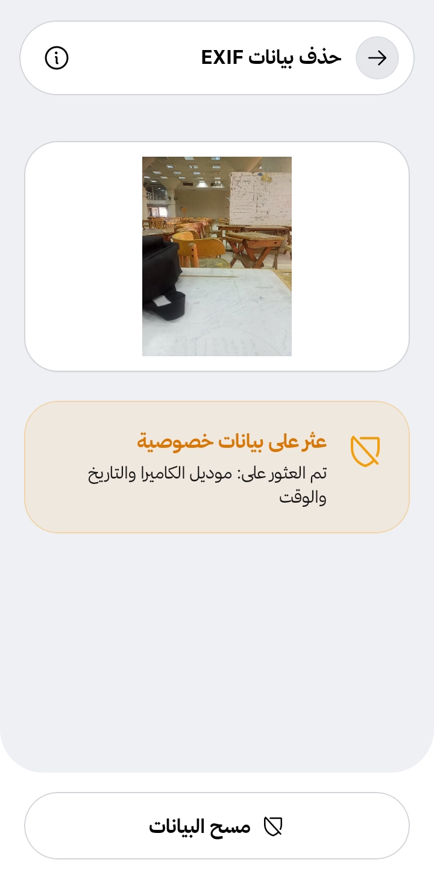
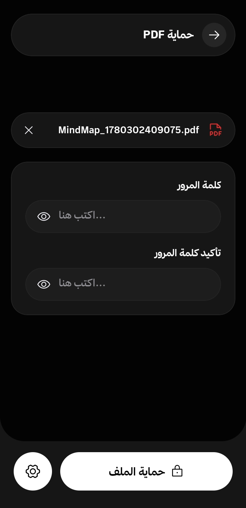
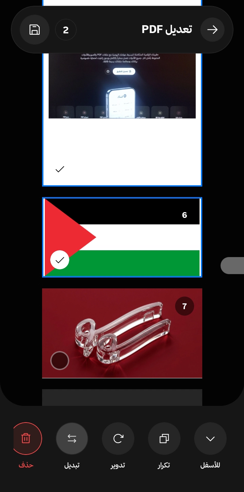

# عتاد - Atad

<h3 align="center">
  تطبيق مجاني يتضمن أكثر من 14 أداة إنتاجية تعمل محليًا لتحرير ملفات البي دي اف والصور وغيرها من الأدوات المفيدة
</h3>

<a href="README.md">English</a>
&nbsp;&nbsp;| &nbsp;&nbsp;
العربية

 

 

 

 

## ✨ المميزات

* أكثر من 14 أداة إنتاجية للبي دي اف والصور بالإضافة إلى أدوات أخرى مفيدة.
* جميع الأدوات تعمل بالكامل محلياً وبدون الاتصال بالإنترنت.
* لا توجد ملفات أو بيانات ترسل إلى سيرفرات خارجية.
* يتم تحويل ملفات PDF وضغط الصور وتشفيرها محلياً بسرعة فائقة بفضل تقنيات معالجة البيانات الحديثة.
* يعمل في الخلفية لذا يمكنك الاستمرار in استخدام الهاتف أثناء الانتظار وسيرسل لك إشعار فور الانتهاء.
* استمتع بتجربة استخدام نظيفة وسريعة بدون إعلانات أو أدوات تتبع.
* لا توجد اشتراكات أو حدود استخدام أو عرض إعلانات.. تطبيق مجاني بالكامل.
* أكثر من 5 أدوات لتحرير ملفات البي دي اف.
* 4 أدوات لتحويلات وضغط الصور.
* بالإضافة إلى أدوات أخرى متنوعة مثل إنشاء خرائط ذهنية - إنشاء وقراءة كود QR - مستخرج الألوان - إنشاء خلفيات.
* خيارات إضافية لكل أداة.
* التطبيق يدعم 3 لغات: العربية - الإنجليزية - الإسبانية.

 

## 📸 لقطات

  &nbsp;&nbsp;
  &nbsp;&nbsp;
  &nbsp;&nbsp;
  &nbsp;&nbsp;
  &nbsp;&nbsp;
  &nbsp;&nbsp;
  &nbsp;&nbsp;
  &nbsp;&nbsp;
  &nbsp;&nbsp;

 

## 📥 التحميل

يمكنك تحميل أحدث إصدار من التطبيق عبر صفحة [الإصدارات](https://github.com/you0ssef/Atad/releases)

> 💡 **تلميح:** إذا كنت لا تعرف النسخة المتوافقة مع جهازك، يرجى تحميل نسخة **Universal** فهي تعمل على جميع الأجهزة المدعومة.

 

## 💬 الإبلاغ عن المشكلات والاقتراحات

هل وجدت مشكلة أو لديك اقتراح؟ يرجى فتح **[تذكرة (Issue)](https://github.com/you0ssef/Atad/issues)**

 

## 📜 الترخيص

تطبيق عتاد مجاني للاستخدام  
جميع الحقوق محفوظة ©

